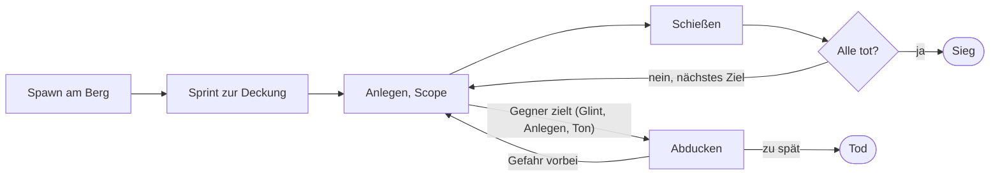

# Ridgeline – Spielkonzept

Stand: 1. November 2026 · Original: [Claude-Doc „Ridgeline – Spielkonzept“](https://claude.ai/artifact/BJbq2tQ7BMiE28AcRPBPR1)

> Das Konzept beschreibt den ursprünglichen Plan. Was sich bei der Umsetzung geändert hat, steht am Ende unter
> [Änderungen seit dem Konzept](#änderungen-seit-dem-konzept).

## Vision & Eckdaten

Ridgeline (Arbeitstitel) ist ein Scharfschützen-Duell im Browser: Du gegen 2–5 Gegner auf einem prozeduralen Berg. Wer zuerst getroffen wird, verliert.

- **Modus:** Single Player, Runde für Runde, kein Account, keine Progression im ersten Release
- **Rundenende:** Du bist tot oder alle Gegner sind ausgeschaltet
- **Rundenlänge:** offen, typisch 3–8 Minuten je nach Gegnerzahl
- **Kern-Spannung:** Zielen dauert, Gegner zielen zurück – du musst ihre Warnsignale lesen und rechtzeitig abtauchen
- **Plattform:** Desktop-Browser (Chrome, Edge, Firefox, Safari) mit Maus und Tastatur
- **Grafik:** möglichst realistisch, innerhalb dessen, was WebGL2 flüssig schafft

## Rundenablauf

Jede Runde startet gleich: Du stehst an einem zufälligen Punkt eines neu generierten Bergs, eine gescriptete Kamerafahrt von 3–4 Sekunden bringt dich hinter die Deckung, dann legst du an.



Danach wechselst du zwischen Zielen und Abducken. Wer ein Warnsignal übersieht oder zu spät abtaucht, wird getroffen; nach jedem Treffer geht es zum nächsten Gegner, bis keiner mehr steht.

## Deckungsarten

Die Deckung wird pro Runde zufällig gewählt und verändert, wie riskant Zielen ist: Tarnung und Schutz sind getrennte Werte.

| Deckung | Tarnung (Entdeckungszeit) | Schutz beim Ducken | Sichtfeld beim Zielen | Besonderheit |
| --- | --- | --- | --- | --- |
| Busch | hoch | keiner – durchschießbar | weit | Gegner schießen auf Verdacht ins Gebüsch |
| Felsblock | mittel | voll | weit | Silhouette über dem Stein fällt auf |
| Holzhütte (Fenster) | hoch | voll | eng (Fensterrahmen) | Fenster liegt im Schatten, Glint schwächer |
| Holzstapel | mittel | teilweise (dickes Holz hält) | mittel | Splitter-Effekt bei Treffern |
| Autowrack | niedrig | voll | mittel | Metall reflektiert, Gegner finden dich schneller |

## Gegner

Jede Runde mischt 2–5 Gegner aus vier Typen; mindestens einer kann dich treffen. Ein Treffer auf Kopf oder Torso tötet den Gegner, ein Beintreffer verwundet ihn.

| Typ | Verhalten | Gefahr | Wie er dich findet |
| --- | --- | --- | --- |
| Wachposten | steht, dreht sich, langsame Reaktion | schießt erst nach Alarm | Sichtkegel, schlecht auf Distanz |
| Patrouille | läuft Wegpunkte ab, bewegtes Ziel | schießt nach Alarm, ungenau | Sichtkegel, Geräusche |
| Scharfschütze | liegt in Deckung, scannt das Gelände, wechselt Position | Hauptgefahr – präzise auf jede Distanz | eigenes Zielfernrohr, hört deinen Schuss |
| Spotter | Fernglas, läuft zwischen Posten | schießt nicht | entdeckt dich schnell und alarmiert alle |

### Warnsignale, bevor auf dich geschossen wird

1. **Anlege-Animation** – der Gegner hebt das Gewehr (nur im Scope gut erkennbar)
2. **Zielfernrohr-Glint** – ein Lichtreflex, abhängig vom Sonnenstand; wird heller, je näher der Schuss ist
3. **Audio** – Repetiergeräusch (nur bei kurzer Distanz hörbar) und dein eigener Herzschlag, der schneller wird

Zwischen Glint-Maximum und Schuss bleibt ein Reaktionsfenster, das von der Schwierigkeitsstufe abhängt (siehe unten). Wer in diesem Fenster abtaucht, wird verfehlt; die Kugel schlägt sichtbar neben dir ein.

### Reaktion auf deinen Schuss

Knall und Mündungsfeuer verraten deine Richtung, umso genauer je näher die Gegner sind und je offener deine Deckung ist. Gegner gehen dann in Deckung, suchen den Sektor ab und werden mit jedem weiteren Schuss nervöser und schneller. Ein Schalldämpfer ist bewusst nicht vorgesehen.

## Ballistik & Einflussfaktoren

Die Ballistik ist eine echte Flugbahnsimulation: Die Kugel ist ein Projektil mit Luftwiderstand, Schwerkraft und Wind, kein Raycast.

### Waffe und Zielfernrohr

- Repetierer im Kaliber .308 Win (790 m/s, quadratischer Luftwiderstand, numerisch integriert mit 1-ms-Zeitschritt)
- Flugzeit sichtbar: auf 600 m rund 0,9 s – bewegte Ziele brauchen Vorhalt
- Mil-Dot-Absehen in der ersten Bildebene (Mil-Werte gelten bei jeder Vergrößerung)
- **Zeroing** in 50-m-Schritten (100–1000 m) per R + Mausrad; die Fleckschussdistanz steht im HUD
- Kein Laser-Entfernungsmesser: Distanz wird über das Absehen geschätzt (ein Mensch ≈ 1,8 m hoch)

```
Distanz [m] = Zielgröße [m] × 1000 / Größe im Absehen [mil]
```

### Einflussfaktoren

| Faktor | Wirkung auf den Schuss | Wie du ihn liest | Gegenmittel |
| --- | --- | --- | --- |
| Wind | seitliche Abdrift, wächst mit Distanz und Flugzeit | Gras, Baumwipfel, Fahnen, Rauch, treibender Staub | seitlich vorhalten (Mil) |
| Böen | Wind ändert Stärke und Richtung alle paar Sekunden | Fahnen und Wipfel bewegen sich sichtbar | Ruhephase abwarten |
| Atmung | Absehen wandert in einer Acht | Bewegung im Scope | Luft anhalten (Shift) max. ~6 s, danach stärkeres Zittern |
| Puls | nach dem Sprint und nach knappen Treffern erhöht, Absehen zuckt im Herzschlag | Herzschlag-Sound | warten, ruhig atmen – kostet Zeit |
| Wetter/Sicht | Nebel und Regen senken Sichtweite, Gegenlicht überstrahlt | Atmosphäre pro Runde zufällig | Position der Sonne beachten |
| Höhenwinkel | bergab/bergauf trifft man zu hoch, wenn man die Schrägdistanz einstellt | Neigungsanzeige im HUD | horizontale Distanz verwenden (Schrägdistanz × cos Winkel) |

### Bullet-Cam

Beim tödlichen Treffer auf den letzten Gegner: Zeitlupe vom Lauf bis zum Einschlag, überspringbar mit Leertaste.

## Jev als Taktik-Direktor

Jev (TypeSafe System-One-Modell) entscheidet die Taktik aller Gegner in einem Aufruf alle 1,5 s und bei Ereignissen; alles, was in Millisekunden passieren muss (Zielen, Glint, Schuss, Treffer), bleibt lokal im Spiel.

### Was Jev bekommt

Der Lagezustand wird in Worte übersetzt, weil Jev bei Zahlen schwach ist – z. B. „Scharfschütze, vorsichtiger Veteran“, „eine Kugel ist eben knapp neben ihm eingeschlagen“, „ein Kamerad ist gefallen“.

### Welche Fragen Jev beantwortet

| Frage | Typ | Optionen / Skala | Wirkung im Spiel |
| --- | --- | --- | --- |
| Nächste Aktion | Choice | beobachten · anlegen und zielen · Position wechseln · Kameraden alarmieren · in Deckung bleiben | Zustandsmaschine des Gegners springt in diesen Zustand |
| Spieler entdeckt? | Ja/Nein (`noul`) | ja / nein | verstärkt die Wahrnehmung, nur wenn der Gegner dich tatsächlich sieht |
| Nervosität | Choice über Skala | ruhig … panisch | Reaktionszeit, Zeit bis zum Schuss |

Die Aktion wird nicht als höchste Wahrscheinlichkeit übernommen, sondern danach gewürfelt. So bleiben Gegner glaubwürdig, aber nicht auswendig lernbar. Die Optionsreihenfolge bleibt fest, weil Jev auf Reihenfolge reagiert. Antwortet Jev nicht innerhalb von 900 ms, entscheidet eine lokale Utility-KI mit denselben Optionen.

## Grafik & Technik

Gebaut mit Three.js, TypeScript und Vite. Realistische Optik entsteht vor allem durch Licht, Atmosphäre und Vegetation, nicht durch Polygonzahl.

| Bereich | Umsetzung |
| --- | --- |
| Himmel & Licht | physikalischer Himmel (Sky-Shader) als Umgebungslicht, gerichtete Sonne, ACES-Tone-Mapping, Tageszeit pro Runde |
| Terrain | prozedurale Höhenkarte (Simplex-Noise, Grat + Tal + Gegenhang), Shader mischt Gras, Erde, Fels, Schnee nach Neigung und Höhe |
| Vegetation | Nadelbäume aus Zweigkarten, Büsche, Gras – instanziert, in Kacheln für Culling, Wind im Vertex-Shader |
| Schatten | Schattenkamera folgt dem Blickpunkt (scharfe Schatten dort, wo du hinschaust) |
| Atmosphäre | Exponentialnebel je Wetter, Regen als Partikel |
| Post-Processing | Bloom (für den Glint), SMAA, Vignette (pmndrs/postprocessing) |
| Zielfernrohr | Sichtfeld der Kamera nach Vergrößerung, Linsenschatten und Absehen als Overlay |
| Figuren | prozedurale Soldatenmodelle mit Posen (stehen, laufen, liegen, anlegen, Fernglas, fallen) |
| Sound | prozedural mit WebAudio: Schuss, Hall und Echo im Tal, Wind, Vögel, Regen, Herzschlag, Repetieren, Einschläge |

## Steuerung & HUD

| Aktion | Taste |
| --- | --- |
| Umsehen / Zielen | Maus |
| Anlegen / Zielfernrohr | rechte Maustaste (halten) |
| Schießen | linke Maustaste |
| Abducken | Leertaste oder S |
| Aufrichten ohne Zielfernrohr | W |
| Stellung wechseln (links / rechts) | A / D |
| Luft anhalten | Shift (halten) |
| Zoom | Mausrad |
| Zeroing | R + Mausrad |
| Gegner markieren | Q oder mittlere Maustaste |
| Funk-Einweisung | Tab (halten) |
| Debug-Overlay | I (oder F3) |
| Pause | Esc |

## Meilensteine

1. **Grundgerüst:** Vite + Three.js + TypeScript, prozeduraler Berg mit Himmel, Licht und Nebel
2. **Schießen:** Zielfernrohr, Ballistik mit Wind, Zeroing, Mil-Absehen
3. **Rundenablauf:** Spawn, Kamerafahrt zur Deckung, Anlegen, Ducken, Tod und Sieg, zufällige Deckungsarten
4. **Gegner:** vier Typen mit Animation, Sichtkegel, Warnsignalen und lokaler Utility-KI
5. **Jev:** Lageübersetzung, Jev-Client, Fallback, Debug-Overlay
6. **Realismus-Pass:** Vegetation mit Wind, Schatten, Post-Processing, Wetter, Sound, Bullet-Cam
7. **Feinschliff:** Balancing, Qualitätsstufen, Ladebildschirm, Menü

Entscheidungen aus den offenen Punkten: modernes Setting, Schwierigkeitsstufen ja, Jev über den Standard-Endpoint `https://api.typesafe.ai/v1/systemone`.

## Änderungen seit dem Konzept

Nach den ersten Testrunden angepasst:

- **Schwierigkeitsstufen** (Werte in `src/config.ts`):

  | Stufe | Gegner | Distanz | Reaktionsfenster | Treffer, die du aushältst | Markieren |
  | --- | --- | --- | --- | --- | --- |
  | Leicht | 2–3 | 150–320 m | 2,0 s | 3 | alle automatisch, mit Distanz |
  | Normal | 2–4 | 200–450 m | 1,5 s | 2 | per Taste, mit Distanz |
  | Schwer | 3–5 | 250–600 m | 1,15 s | 2 | per Taste, ohne Distanz |
  | Elite | 4–5 | 300–780 m | 0,85 s | 1 | keine |

- **Nicht mehr sofort tot:** Außer auf Elite verwundet dich der erste Treffer nur. Das Spiel geht kurz in Zeitlupe, markiert den Schützen und zeigt mit Kreis oder Pfeil auf ihn, damit du zurückschlagen kannst.
- **Gegner näher und größer:** engeres Tal, Modelle 10 % größer, Zoom 4–20×, weniger Dunst.
- **Funk-Einweisung** zu Rundenbeginn mit Richtung in Grad und Entfernung je Gegner.
- **Windanzeige** auf Leicht und Normal, Kugelspur nur auf Leicht.
- **Jev über Proxy:** Der Browser ruft `/jev-api` auf, der Vite-Server leitet weiter und hängt den Key an (kein CORS-Problem, Key nicht im Browser-Code). Auf GitHub Pages gibt es keinen Server, dort steuert die lokale KI.
- **Debug-Overlay** auf Taste I (F3 ist auf dem Mac belegt), mit Gegner-Markierungen.
- **Menü:** Grafikstufe, Maus-Empfindlichkeit, Lautstärke, Statistik.
- **Assets:** Texturen, Modelle und Sounds sind prozedural erzeugt statt aus Poly Haven, Mixamo und Freesound.
- **Handy-Variante:** Touch-Steuerung im Querformat (Wischen zum Zielen, Pinch-Zoom, Tasten für Feuer, Anlegen, Ducken, Atem, Fleckschuss, Markieren, Funk). Wird auf Touch-Geräten automatisch aktiv, Grafik startet auf „Niedrig“; hochkant pausiert das Spiel.
- **Moerserbeschuss und Stellungswechsel:** Auf dem Grat stehen neben deiner Deckung bis zu zwei Ausweichstellungen
  (25–60 m links und rechts, andere Deckungsart). Jeder eigene Schuss und jede Sekunde, in der dich ein Gegner ungedeckt
  sieht, fuellt die Anzeige „Stellung verraten“. Bei 100 % fordert der Gegner Moerserfeuer an: Countdown
  (16 / 13 / 11 / 9 s je Stufe, 2 s weniger, wenn der Spotter funkt), dann drei Gabelschuesse, die vom Gegenhang her
  auf dich zuwandern, und drei Schuss Wirkungsfeuer. Wer bleibt, wird getroffen. Mit A / D sprintest du geduckt hinter
  dem Grat zur naechsten Deckung (kurz ungedeckt, aber schwer zu treffen); danach verlieren die Gegner deine Spur und
  der Beschuss geht auf die alte Stellung. Faellt der Spotter vor dem ersten Einschlag, platzt der Feuerauftrag.
